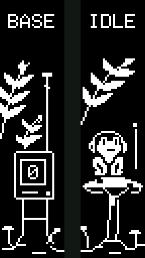

# Frog Station

This is the OLED setup I use on my Lily58. It runs on Vial, with an optional Mac
app for Spotify.

32×128 per screen, enlarged 4×. [All animations](docs/animations.md).

The left screen shows the current layer and held modifiers. The frog on the
right reacts to typing, with a small meter showing typing speed.

When Spotify is playing, the frog switches to a music animation. That part needs
the Mac app; everything else runs on the keyboard.

## Install

- [Mac companion](docs/macos.md) · [download preview](https://github.com/msnidal/frog-station/releases)
- [Build and flash firmware](docs/firmware.md)
- [Adapt to another board](docs/porting.md)

Tested hardware: KeyboardHoarders Lily58/rev1, RP2040 controllers using
`rp2040_ce`, two 128×32 OLEDs mounted vertically, Vial. The Mac app requires
macOS 13 or later and supports Apple Silicon and Intel.

This is a private preview. The Mac download is locally signed, not notarized.
The example keymap is based on the vendor layout; export your Vial layout before
flashing and restore it afterwards.

## Source

[Build and test](docs/development.md) · [Host protocol](docs/host-protocol.txt) ·
[Credits](CREDITS.md) · [GPL-3.0-or-later](LICENSE)
