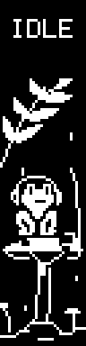
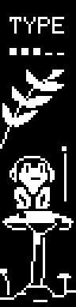
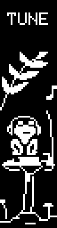
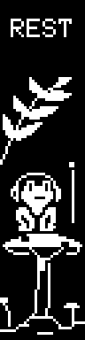
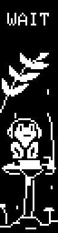
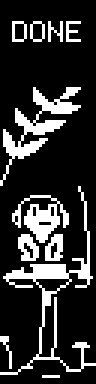
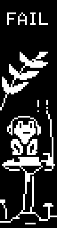

# Animations

Firmware pixels at 3×, with their authored timings. Each gallery clip repeats for
inspection; WAIT, DONE, FAIL and SLEEP play once per state entry on the keyboard.

| Idle | Typing | Spotify | Sleep |
| --- | --- | --- | --- |
|  |  |  |  |

The frog taps a field key while typing; the meter estimates recent pace. Spotify
adds a note and a small nod. Typing takes visual priority while the note remains.
Rain starts at the top and stops at the swaying ferns, sheltering the scene below.
Labels and active indicators stay clear. Sleep ends with the OLED off.

| Work | Wait | Done | Fail |
| --- | --- | --- | --- |
|  |  |  |  |

These four states need an external sender using the [host protocol](host-protocol.txt).
The Mac companion only supplies Spotify playback state.

[Native-resolution two-screen demo](demo-native.gif). Browser scaling and display
density affect apparent size; each panel contains exactly 32×128 pixels.
